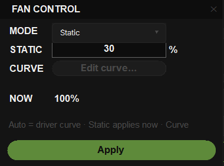

# Nv-Lightning

Windows tuning and monitoring tool for NVIDIA GPUs. It talks to the driver directly, verifies
every value it writes, and covers **Turing and newer** (developed and verified on an RTX 2080).

## The app, view by view

### Main window — live monitoring and tuning

The tiles at the top are read-only telemetry: core, memory, XBAR and SYS clocks, temperature,
voltage, power draw and power limit. Below them are the tuning block, the bundled NIP profile
and the telemetry switch. The three buttons at the top right open **Profiles**, **Fan** and
**Tuning**.

### Tuning — clock offsets, voltage and the V/F curve

Sliders for the four clock domains (core, memory, **XBAR**, **SYS**), the current voltage
readout and the card's voltage/frequency curve. `Apply` writes everything and verifies it;
`Revert` puts back what was there before. A value of `0` means *no offset* — `0 + Apply` is the
documented way back to default.

### Fan control — auto, static or your own curve

`Auto` hands the fan back to the card. `Static` holds a fixed percentage. `Curve` lets you draw
a temperature → speed curve with hysteresis, so the fan does not hunt around a threshold. The
`NOW` line shows what the fan is doing at this moment.

### Profiles — save, overwrite, apply

Every profile stores the whole tuning (clock offsets, power limit, fan mode and voltage lock)
and shows a summary line. `Apply` restores it, `Save as…` asks for a name — type a new one or
pick an existing profile to overwrite it — and `Delete` removes it. The same dialog holds the
optional shutdown timer.

## What it does

- **Clock offsets** for core, memory, XBAR and SYS. Core and memory are the usual overclock;
  XBAR and SYS are the GPU's internal interconnect and system domains, which almost nothing
  else exposes — nudging them helps in bandwidth-bound situations.
- **Voltage lock**: pin the core to a fixed voltage point, or to the lowest one your card
  offers, instead of letting the boost algorithm roam. That is how you trade a little clock for
  a lot less heat and noise, or stabilise a frequency you already picked.
- **Power limit**: raise it so the GPU stops throttling early, or lower it to keep the card
  quiet and cool.
- **Fan control**: auto, fixed percentage, or your own curve with hysteresis.
- **Named profiles**: save your setup, overwrite it, recall it in one click. Nothing is shipped
  with the tool — the list starts empty and fills with your own configurations.
- **Apply at logon**: the last tuning you applied comes back after a reboot.
- **Telemetry ring**: one line per second with temperature, power, voltage and clocks, flushed
  to disk immediately. If the machine ever hangs, the last line on disk is the last state it
  reported — evidence instead of "it crashed and I don't know why".
- **ReBAR status**: whether Resizable BAR is active and what window size the driver exposes,
  plus two bundled NVIDIA Profile Inspector profiles (ReBAR base and an Edge profile).

## Install and use

1. Download `Nv-Lightning.exe` from the **[releases page](https://github.com/ianEstrada/Nv-Lightning/releases)**.
2. Run it **as administrator** (applying tuning needs it; monitoring alone does not).
3. **TUNING** → set what you want → **Apply All**. The dialog tells you which domains your card
   reports as ready.
4. **PROFILES → Save as…** → type a name. Press **Apply** on it any time to come back.
5. Enable the logon task if you want it reapplied automatically at boot.

Profiles live in `%ProgramData%\Nv-Lightning\profiles.json` — one file, easy to back up. If it
ever becomes unreadable it is parked as `profiles.json.bad-<timestamp>`, never deleted.

## Why this tool

- **Turing and newer** — covers the generations several tuning tools skip.
- **XBAR and SYS** — the clock domains almost nothing else exposes.
- **It tells you the truth** — every write is read back; a value the driver ignores is reported
  as a failure and the previous state is restored.
- **It leaves evidence** — the telemetry ring survives a hard hang.

Inspired by **[mVolt+](https://github.com/b00nz/mVolt)**, which targets Blackwell (RTX 50) and
showed what talking to the driver directly can expose. A caution that comes with that lineage:
these are undocumented driver interfaces, and NVIDIA can break them with a driver update — it
already happened to mVolt+ once.

## Credits

- **Lightning** — the tool, the XBAR/SYS domain work and the driver research behind it.
- **Succes** — collaboration on the NIP / ReBAR profile research and the bundled `.nip` profiles.
- **Orbmu2k** — author of NVIDIA Profile Inspector, bundled inside the tool (its own license).

## License

**CC BY-ND 4.0** — free to use and share, no modified redistributions, attribution required.
Full text: [LICENSE.md](LICENSE.md).
