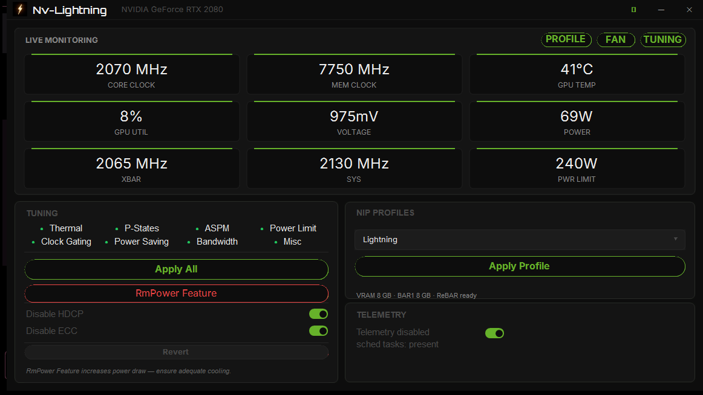
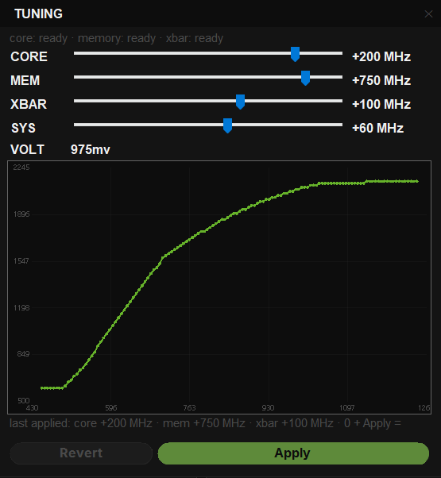
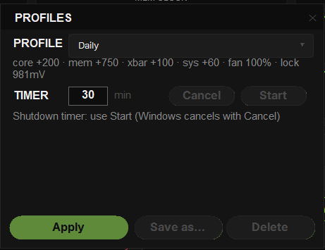

# Nv-Lightning

Windows tuning and monitoring tool for NVIDIA GPUs. It talks to the driver directly, verifies
every value it writes, and covers **Turing and newer** (developed and verified on an RTX 2080).

## What it does

**Clock offsets — core, memory, XBAR and SYS.** Core and memory are the usual overclock.
XBAR and SYS are the GPU's internal interconnect and system domains: almost nothing else lets
you touch them, and nudging them helps in bandwidth-bound situations.

**Voltage lock.** Pin the core to a fixed voltage point — or to the lowest one your card
offers — instead of letting the boost algorithm roam. That is how you trade a little clock for
a lot less heat and noise, or stabilise a frequency you already picked.

**Power limit.** The wattage ceiling the card is allowed to draw. Raise it so the GPU stops
throttling early; lower it to keep the card quiet and cool.

**Fan control.** Auto (the card's own curve), a fixed percentage, or your own temperature →
speed curve with hysteresis so it does not hunt around a threshold.

**Profiles.** Save the whole combination under a name you choose, overwrite an existing one,
apply it in one click. Nothing is shipped with the tool: the list starts empty and fills with
your own setups.

**Apply at logon.** Optional: the last tuning you applied comes back after a reboot, so you do
not have to redo it every morning.

**Telemetry ring.** One line per second with temperature, power, voltage and clocks, flushed to
disk immediately. If the machine ever hangs, the last line on disk is the last state it
reported — that is the evidence, instead of "it crashed and I don't know why".

**ReBAR status and two driver profiles.** Tells you whether Resizable BAR is active and what
window size the driver exposes, and bundles two NVIDIA Profile Inspector profiles (ReBAR base
and an Edge profile).

## Install and use

1. Download `Nv-Lightning.exe` from the **[releases page](https://github.com/ianEstrada/Nv-Lightning/releases)**.
2. Run it **as administrator** (applying tuning needs it; monitoring alone does not).
3. **TUNING** → set what you want → **Apply All**. The panel tells you which domains your card
   reports as ready.
4. **PROFILES → Save as…** → type a name. Press **Apply** on it any time to come back.
5. Enable the logon task if you want it reapplied automatically at boot.

`0 + Apply` means *back to default*: it clears the stored offset. That is the clean way to undo
a tuning you no longer want.

Profiles live in `%ProgramData%\Nv-Lightning\profiles.json` — one file, easy to back up. If it
ever becomes unreadable it is parked as `profiles.json.bad-<timestamp>`, never deleted.

## Why this tool

- **Turing and newer** — covers the generations several tuning tools skip.
- **XBAR and SYS** — the clock domains almost nothing else exposes.
- **It tells you the truth** — every write is read back; a value the driver ignores is reported
  as a failure and the previous state is restored.
- **It leaves evidence** — the telemetry ring survives a hard hang.

Inspired by **[mVolt+](https://github.com/b00nz/mVolt)**, which targets Blackwell (RTX 50) and
showed what talking to the driver directly can expose. A caution that comes with that lineage:
these are undocumented driver interfaces, and NVIDIA can break them with a driver update — it
already happened to mVolt+ once.

## Credits

- **Lightning** — the tool, the XBAR/SYS domain work and the driver research behind it.
- **Succes** — collaboration on the NIP / ReBAR profile research and the bundled `.nip` profiles.
- **Orbmu2k** — author of NVIDIA Profile Inspector, bundled inside the tool (its own license).

## License

**CC BY-ND 4.0** — free to use and share, no modified redistributions, attribution required.
Full text: [LICENSE.md](LICENSE.md).
